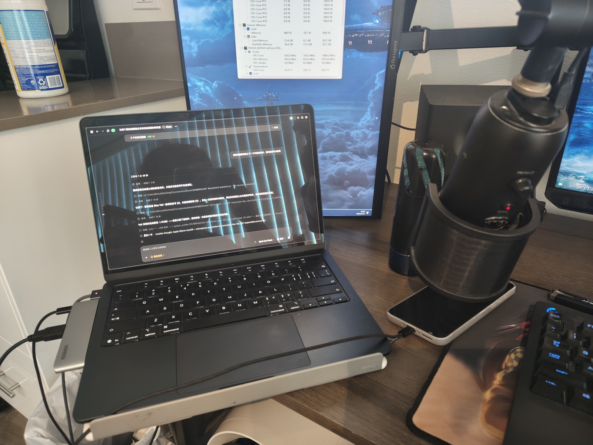

# AI Call Assistant (specialized for OPPO-series phones + MacBook) · Scope Document

[中文](README.md) | English

> ## ⚠️ Project status: development paused (since 2026-11-13)
>
> **Why — the core difficulties and unrealistic parts of the "one-device plan"**: the project's end goal was "one ordinary phone + one app = the full experience" (auto-answer, speaking the greeting into the call, recording the caller, on-device AI summary — fully offline). After several rounds of research, the conclusion is that this cannot become a realistic, production-grade product:
>
> 1. **Call audio is system-level off-limits**: Android reserves digital access to the call stream (`CAPTURE_AUDIO_OUTPUT`, a signature-level permission) for system apps, and offers no public API to inject audio into the call's uplink either — third parties are left with only the "speakerphone → microphone" acoustic loopback, which has hard ceilings on audio quality, echo, ambient noise and over-hearing privacy. This is by OS design and has stayed closed for years.
> 2. **The correct form is monopolized by system-level products**: Pixel Call Screen, Samsung Bixby Text Call and Xiaomi 小爱通话 all implement the same "answer + transcribe + summarize" as system apps with digital-path quality, while Google keeps tightening third-party options (the 2022 Play policy banning third-party call recording, the 2026 accessibility crackdown) — squeezing third parties from both the experience side and the policy side.
> 3. **All three bypass routes are unrealistic**: privileged paths (root/Magisk/system signing) lose warranty and shatter with every ROM update; cloud-hosted answering sounds best but betrays this project's fundamental premise that audio never leaves the device; building a custom Android ROM is technically feasible (privileged permissions could be self-granted, the audio HAL could be modified), but the entry ticket is an unlockable-bootloader device (mainstream vendors are closing unlock channels — recent OPPO/Xiaomi models are effectively locked) plus per-SoC audio HAL engineering, far beyond what an individual project can sustain.
>
> The repository keeps the verified **two-device stationary rig** (Mac + phone acoustic coupling, validated on real hardware 2026-09-22) as a personal tool; the "universal one-app full experience" goal (TODO 3) is paused. See the TODO file and the scope document below.

> **This project was created and debugged by ZCode (coding agent, model GLM-5.3-Flash).**
> This README follows the Project Scope Document template (projectmanagementformula.com, 9 sections), restructured 2026-10-06; engineering entry points (quick start / repository structure / privacy) are kept as appendices. English version synced 2026-10-31.

## 1. Project Information

| Item | Content |
|---|---|
| Project name | AI Call Assistant — away-mode auto-answer + message taking + local AI summary |
| Author | The author (project owner) |
| Created & debugged by | ZCode (GLM-5.3-Flash) |
| Started | 2026-09-12 (feasibility analysis) |
| Document version | v2.1 (Scope Document restructure + paused-development notice) |
| Last updated | 2026-11-13 (marked as paused, with the one-device-plan rationale) |

## 2. Overview

**Problem**: calls go unanswered when you're away and messages are lost; carrier voicemail is a poor experience and carrier-dependent. **Solution**: a laptop (MacBook) + one Android phone (USB + ADB only, zero installation on the phone) form an "AI secretary" — when a call rings unanswered for 10 seconds it is answered automatically, a customizable multilingual greeting (including a recording notice) is played, the caller's message is recorded, and after hang-up transcription (mlx-whisper) and AI summarization (ollama) run entirely locally. **No cloud dependency end to end.** **Success measure**: the full pipeline has been verified on real hardware (achieved 2026-09-22 on a OnePlus Ace 5 Ultra + MacBook Air).

## 3. In-Scope Deliverables

| Deliverable | Description | Acceptance | Status |
|---|---|---|---|
| `code/assistant.py` state machine | Ring detection → policy → 10 s auto-answer → greeting → beep → recording → hang-up → transcribe → summarize | Full pipeline verified on real hardware | ✔ 2026-09-22 |
| Mac output volume management | Save current volume before the call → set 70% and unmute → restore in `finally` | Get/set round-trip verified (once caught the Mac at 0%/muted, proving the need) | ✔ 2026-09-22 |
| Local transcription + summary pipeline | mlx-whisper medium + ollama qwen2.5-7B-instruct | Installed and tested | ✔ 2026-09-22 |
| Recording SNR optimization | RNNoise neural denoise + 80–3800 Hz band-pass + placement tuning | Ongoing improvement | In progress |
| Conversation upgrade (TODO 1) | Analyze → reply → multi-turn dialogue; persona presets (probing / minimal) | Turn-wise transcription, TTS outlet, dialogue policy, style switching usable | Paused (with the project, 2026-11-13) |
| Fully-muted usability with elevated phone privileges (TODO 2) | ADB enhancements → Shizuku → root/Magisk digital path | Full pipeline with the phone completely muted, zero intervention | Paused (with the project, 2026-11-13) |
| ⭐Universal one-app full experience (TODO 3) | One ordinary Android app carrying everything (route A public APIs / B privileged digital path / C cloud-hosted contrast) | Any Android 9+ phone works with no computer | ⚠️ Paused (2026-11-13, see the notice above) |

## 4. Out of Scope

- Cloud-hosted call answering (carrier call forwarding → cloud robot): recorded only as the contrast for TODO 3, not a goal;
- Adaptation to non-OPPO/OnePlus models and other brands (the architecture carries over; the core limitation is universal);
- Windows/Linux host support;
- Any audio/text leaving the machine — recordings and summaries never touch the cloud.

## 5. Assumptions

- The phone stays USB-connected with ADB authorization (also charging);
- ColorOS's "USB debugging (Security settings)" toggle stays on (a prerequisite for simulated key presses);
- macOS has granted microphone permission to the terminal app (note: without it macOS returns silence instead of an error);
- Local models are good enough: mlx-whisper medium transcription + qwen2.5-7B summarization suffice for personal use.

## 6. Constraints

- **Android does not expose the call audio stream** (`CAPTURE_AUDIO_OUTPUT` is signature-level, by design) — third parties only get the "speaker → microphone" acoustic coupling; this is the project's most fundamental constraint;
- Depends on the ColorOS-specific toggle and `dumpsys telephony.registry` field formats (version-sensitive, see below);
- The acoustic chain is limited by physical placement (earpiece slit to mic, bottom mic to Mac speakers);
- Verified version combination (2026-09-22): macOS 26.6.2 / ColorOS V16.1.0 (OnePlus Ace 5 Ultra PLC110) / Python 3.14 / adb 37.0.1 / ffmpeg 9.0.2 / mlx-whisper 0.4.3 / ollama qwen2.5:7b-instruct-q4_K_M; O+ Connect 16.2.10/16.25.6 (optional, screen mirroring only).

## 7. Success Criteria

- An incoming call is detected and auto-answered within ≤10 s of ringing, with the "message will be recorded" notice in the greeting;
- The message recording can be transcribed and summarized into readable text, with zero cloud dependency;
- (after TODO 2) the full pipeline runs unattended with the phone completely muted;
- (after TODO 3) any Android 9+ phone gains all of the above by installing a single app.

## 8. Change Control

- The repo is managed in git: scope changes are recorded via commits and [TODO.md](TODO.md) checkboxes;
- Major architecture pivots (e.g. the TODO 3 route A/B/C choice) update the local *Generalization Research* doc first, then code;
- Research corrections are logged in-document (e.g. the retraction of the non-existent `CAPTURE_TELECOM` permission).

## 9. Approvals

| Role | Person/Tool | Date |
|---|---|---|
| Author | The project owner (unsigned) | — |
| Research & implementation | ZCode (GLM-5.3-Flash) | 2026-10-06 |

---

## Appendix A: How it works

```
OnePlus phone (USB/adb)                 MacBook Air
┌──────────────────┐     dumpsys      ┌───────────────────────────────────┐
│ Stock OS, zero    │◄────────────────►│ assistant.py state machine        │
│ installation      │     keyevent     │ ring detect → policy → auto-answer│
└────────┬─────────┘                  │ after 10 s → greeting → beep →    │
         │ acoustic                   │ record → on hang-up: Whisper →    │
         ▼                            │ LLM summary → transcripts/summaries│
   Mac speakers ──→ phone mic (uplink)│                                   │
   phone earpiece ──→ ext. mic ──→ Mac│                                   │
                                      └───────────────────────────────────┘
```

Key design: half-duplex recording (recording starts only after the greeting finishes — no echo cancellation needed); after answering, "volume up" is pressed repeatedly to maximize call volume; recordings are band-passed 80–3800 Hz in real time; transcription and summarization are fully local.

## Appendix B: Real deployment



## Appendix C: Quick start (details in [code/README.md](code/README.md), Chinese)

```bash
brew install --cask android-platform-tools ffmpeg
brew install ollama && brew services start ollama
pipx install mlx-whisper        # optional; without it, recordings are still saved

cp code/config.example.json code/config.json
python3 code/assistant.py --check        # environment self-check
python3 code/assistant.py --record-test  # recording-channel calibration
python3 code/assistant.py                # run persistently
```

## Appendix D: Repository structure & privacy

```
├── README.md / README.en.md / TODO.md
└── code/  assistant.py · config.example.json · README.md
```

This repository contains **no** call recordings, logs, greeting audio, or personal configuration (`recordings/ transcripts/ summaries/ logs/ greetings/ config.json` are all excluded); the recording notice is embedded in the greeting text, and recordings and summaries are stored locally only. Design research documents (feasibility analysis / deployment plan / computer-based walkthrough / generalization research / on-device & carried-device routes / Android variants & self-built OS research) are kept locally only and are not committed.
