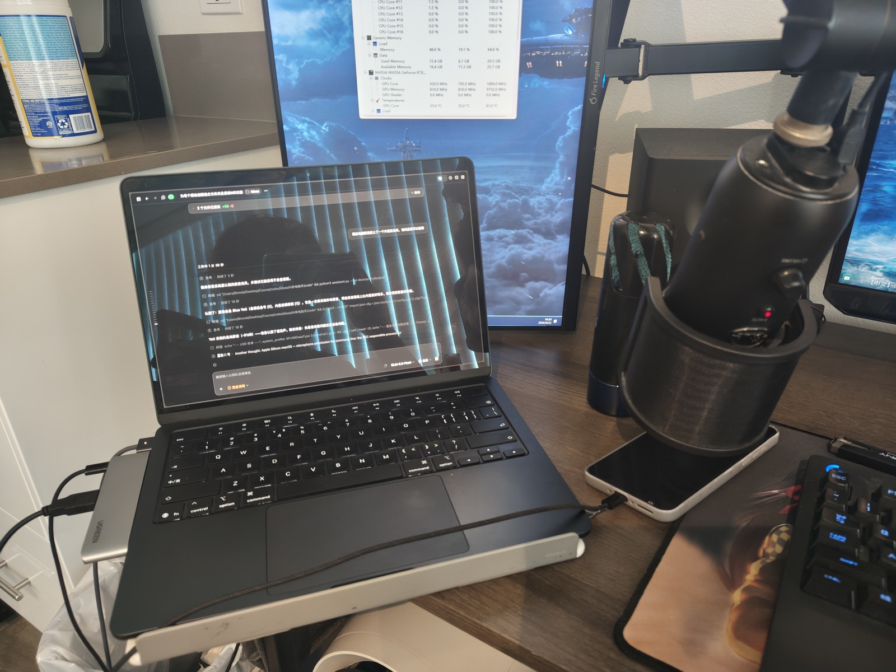

# AI来电助手（OPPO 系列手机 + MacBook 特化版）· Scope Document

中文 | [English](README.en.md)

> ## ⚠️ 项目状态：暂停开发（2026-11-13 起）
>
> **暂停理由——"一机方案"的核心难点与不现实的点**：本项目的最终目标是"一部普通手机装一个 App 即完全体"（自动接听 + 把问候语送进通话 + 录下对方留言 + 端侧 AI 摘要，全程离线）。多轮调研后的结论是该目标无法做成现实的商业级产品：
>
> 1. **通话音频是系统级禁区**：Android 把通话流的数字访问权（`CAPTURE_AUDIO_OUTPUT`，signature 级权限）保留给系统应用，也没有任何公开 API 能把音频注入通话上行——第三方只能走"免提外放 → 麦克风拾音"的声学回路，音质、回声、环境噪声与外放偷听问题都有硬天花板，且这是系统设计使然、多年未放开。
> 2. **正确形态被系统级产品垄断**：Pixel Call Screen、三星 Bixby Text Call、小米小爱通话等全部以系统应用身份实现同样的"代接 + 转写 + 摘要"，体验为数字链路级；同时 Google 在持续收紧第三方方案（2022 年起 Play 政策封杀第三方通话录音、2026 年起收紧无障碍类接听），第三方空间被体验与政策两端挤压。
> 3. **三条绕过路径均不现实**：特权路径（root/Magisk/系统签名）失去保修且随 ROM 更新碎裂，无法规模化；云端代接（运营商呼叫转移）音质最好，但违背本项目"音频不出本机"的根本前提；自建安卓 ROM 虽在技术上可行（特权权限可自签发、音频 HAL 可自改），但入场券是可解锁 bootloader 的设备（主流厂商解锁通道正全面收紧，OPPO/小米新机基本无门）+ 按芯片平台逐一适配的音频 HAL 工程，远超个人项目的可持续规模。
>
> 仓库保留已实测闭环的**双机驻留方案**（Mac + 手机声学耦合，2026-09-22 真机验证）作为个人工具使用；"通用化单 App 完全体"目标（TODO 3）暂停推进，详见仓库 TODO 与下文范围文档。

> **本项目由 ZCode（编码智能体，模型 GLM-5.3-Flash）创建与调试。**
> 本 README 已按 Project Scope Document 模板（projectmanagementformula.com，9 节式）重构（2026-10-06）；工程入口（快速开始/仓库结构/隐私说明）保留为附录。

## 1. 项目信息（Project Information）

| 项 | 内容 |
|---|---|
| 项目名 | AI来电助手——不在场自动接听 + 留言 + 本地 AI 摘要 |
| 提出人 | 作者 |
| 创建与调试 | ZCode（GLM-5.3-Flash） |
| 立项日期 | 2026-09-12（可行性分析） |
| 文档版本 | v2.1（Scope Document 重构 + 暂停开发标注） |
| 最近更新 | 2026-11-13（标注暂停开发及"一机方案"难点理由） |

## 2. 项目概述（Overview）

**问题**：不在场时的来电无人接听，留言信息丢失；运营商语音信箱体验差且依赖运营商。**方案**：笔记本（MacBook）+ 一部安卓手机（仅 USB + ADB，手机零安装）组成"AI 秘书"——响铃 10 秒无人接听时自动接起，播放自定义多语言问候语（含录音告知），采集留言并录音，挂断后本地完成转写（mlx-whisper）与 AI 摘要（ollama），全程无云端依赖。**成功度量**：真机全链路验证通过（已于 2026-09-22 在一加 Ace 5 至尊版 + MacBook Air 上达成初版）。

## 3. 范围内交付物（In-Scope Deliverables）

| 交付物 | 说明 | 验收标准 | 状态 |
|---|---|---|---|
| `code/assistant.py` 状态机 | 响铃检测→策略判断→10s 自动接听→问候语→提示音→录音→挂断→转写→摘要 | 真机全链路实测通过 | ✔ 2026-09-22 |
| Mac 输出音量自动管理 | 通话前保存当前音量→设 70% 并解除静音→finally 恢复 | get/set 往返实测（曾发现 Mac 处于 0%/静音，证明必要） | ✔ 2026-09-22 |
| 本地转写 + 摘要管线 | mlx-whisper medium + ollama qwen2.5-7B-instruct | 装机并实测通过 | ✔ 2026-09-22 |
| 录音信噪比优化 | RNNoise 神经降噪 + 80–3800 Hz 带通 + 摆位调优 | 持续改善中 | 进行中 |
| 对话能力升级（TODO 1） | 分析→回话→多轮对话；persona 预设（追根究底/简洁告知） | 轮次转写、TTS 出口、对话决策、风格切换可用 | 计划 |
| 手机高权限静音可用（TODO 2） | ADB 增强→Shizuku→root/Magisk 数字链路 | 手机完全静音下全链路无人干预 | 计划 |
| ⭐通用化单 App 完全体（TODO 3） | 一个普通安卓 App 承载全部能力（路线 A 公开 API / B 特权数字链路 / C 云托管对照） | 任意 Android 9+ 手机无电脑可用 | 计划 |

## 4. 范围外（Out of Scope）

- 云端托管代接（运营商呼叫转移→云端机器人）：仅作 TODO 3 的对照记录，不是目标；
- 非 OPPO/一加机型适配与其他品牌验证（架构可参考，核心限制共通）；
- Windows/Linux 主机支持；
- 任何音频/文本上云；录音与摘要不离开本机。

## 5. 假设（Assumptions）

- 手机经 USB 常连并保持 ADB 授权（同时供电）；
- ColorOS 的「USB 调试（安全设置）」开关保持开启（模拟按键输入的前提）；
- macOS 已授予终端 App 麦克风权限（注意：未授权时返回静音而非报错）；
- 本地模型质量足够：mlx-whisper medium 转写 + qwen2.5-7B 摘要已满足个人使用。

## 6. 约束（Constraints）

- **Android 不开放通话音频流**（`CAPTURE_AUDIO_OUTPUT` 为 signature 级，系统设计如此）——第三方只能走"扬声器→麦克风"声学耦合，这是全项目最根本的约束；
- 依赖 ColorOS 特有开关与 `dumpsys telephony.registry` 字段格式（版本敏感，见下表）；
- 声学链路受物理摆位限制（听筒缝对麦、底边麦对 Mac 扬声器）；
- 已验证版本组合（2026-09-22）：macOS 26.6.2 / ColorOS V16.1.0（一加 Ace 5 至尊版 PLC110）/ Python 3.14 / adb 37.0.1 / ffmpeg 9.0.2 / mlx-whisper 0.4.3 / ollama qwen2.5:7b-instruct-q4_K_M；O+ Connect 16.2.10/16.25.6（可选，仅投屏监控）。

## 7. 成功标准（Success Criteria）

- 来电响铃 ≤10 s 被检测并自动接听，问候语含"留言将被录音"告知；
- 留言录音可被转写为文本并生成可读摘要，全程无云端依赖；
- （TODO 2 后）手机完全静音场景全链路无人干预；
- （TODO 3 后）任意 Android 9+ 手机仅装一个 App 即获得上述全部能力。

## 8. 变更控制（Change Control）

- 本仓库以 git 提交管理：功能口径变化以 commit + [TODO.md](TODO.md) 勾选留痕；
- 重大架构转向（如 TODO 3 路线 A/B/C 选择）先更新本地《通用化调研.md》再动代码；
- 调研口径修正以文档内「修正记录」条目留痕（例：CAPTURE_TELECOM 权限不存在之更正）。

## 9. 批准（Approvals）

| 角色 | 人/工具 | 日期 |
|---|---|---|
| 提出人 | 作者（待签） | — |
| 整理与实现 | ZCode（GLM-5.3-Flash） | 2026-10-06 |

---

## 附录 A：工作原理

```
一加手机(USB/adb)                    MacBook Air
┌──────────────────┐   dumpsys     ┌─────────────────────────────────┐
│ 原生系统, 零安装   │◄─────────────►│ assistant.py 状态机              │
└────────┬─────────┘   keyevent   │  响铃检测 → 策略判断 → 10s 自动接听│
         │ 声学                    │  → 播放问候语 → 提示音 → 录音     │
         ▼                        │  → 挂断 → Whisper 转写 → LLM 摘要 │
   Mac 扬声器 ─→ 手机麦克风(上行)   │  → transcripts/ summaries/      │
   手机听筒 ─→ 外置麦克风 ─→ Mac录音 │                                 │
                                  └─────────────────────────────────┘
```

关键设计：半双工录音（问候播完才录，免回声消除）；接通后连按"音量上"拉满通话音量；录音实时 80–3800 Hz 带通；转写与摘要全部本地。

## 附录 B：实际部署



## 附录 C：快速开始（详见 [code/README.md](code/README.md)）

```bash
brew install --cask android-platform-tools ffmpeg
brew install ollama && brew services start ollama
pipx install mlx-whisper        # 可选，缺失时只保存录音

cp code/config.example.json code/config.json
python3 code/assistant.py --check        # 环境自检
python3 code/assistant.py --record-test  # 录音通道标定
python3 code/assistant.py                # 常驻运行
```

## 附录 D：仓库结构与隐私

```
├── README.md / README.en.md / TODO.md
└── code/  assistant.py · config.example.json · README.md
```

本仓库**不包含**任何通话录音、日志、问候语音频与个人配置（`recordings/ transcripts/ summaries/ logs/ greetings/ config.json` 均不入库）；录音告知写在问候语文本内，录音与摘要仅存本地。设计调研文档（可行性分析/部署方案/电脑方案详解/通用化调研/本地化与随身设备路线调研/安卓变体与自建OS调研）仅本地留存，不入库。
